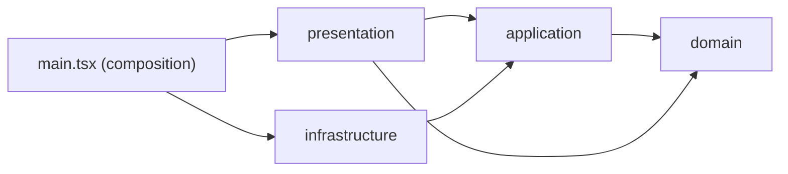
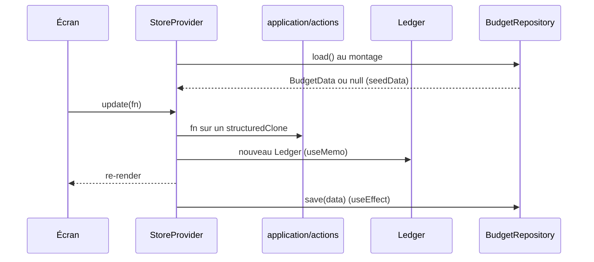

# Architecture — Budget Perso

## 1. Vue d'ensemble

Budget Perso est une application de budget personnel, **desktop uniquement (1440 px)** et **en français**. Elle remplace un Google Sheet et implémente le design Claude Design (`design/project/Budget Perso.dc.html`).

| Élément | Choix |
| --- | --- |
| UI | React 19 |
| Langage | TypeScript 5.9 |
| Build / dev | Vite 8 (port 5180) |
| Tests | Vitest 5 |
| Dépendances runtime | React et React DOM uniquement (pas de routeur, pas de lib d'état) |
| Persistance | `localStorage` aujourd'hui, Supabase prévu |

## 2. Structure des dossiers

Le projet suit la **clean architecture**, les principes **SOLID** et **KISS**.

```
src/
  main.tsx          racine de composition : choisit le repository et l'injecte
  domain/           entités (types) et règles pures : ledger, budget, format, seed
  application/      cas d'usage (actions) et ports (BudgetRepository)
  infrastructure/   implémentations des ports : localRepository (Supabase à venir)
  presentation/     App, screens, components, state (store, ui), ds, app.css
supabase/
  migrations/       schéma SQL et RLS
docs/               documentation
design/             handoff et prototype Claude Design
```

### Règle de dépendance

Les dépendances vont toujours vers l'intérieur.



- `domain` ne dépend de rien.
- `application` dépend de `domain`.
- `infrastructure` implémente les ports d'`application`.
- `presentation` appelle `application` et `domain`, jamais `infrastructure`.
- Seul `main.tsx` connaît les implémentations concrètes.

### SOLID

| Principe | Application dans le projet |
| --- | --- |
| **S** | Un fichier, une responsabilité : `Ledger` calcule, `actions` mute, le store orchestre, `localRepository` persiste. |
| **O** | Ajouter un `SupabaseRepository` ne modifie ni le store ni les écrans. |
| **L** | Tout `BudgetRepository` est interchangeable : `load` renvoie les données ou `null`, `save` écrit l'agrégat. |
| **I** | Ports petits et ciblés : `BudgetRepository` n'a que `load` et `save`. |
| **D** | Le store dépend du port `BudgetRepository` et reçoit `repository` et `initialData` par props. |

### KISS : garde-fous

- Un seul agrégat `BudgetData` et un seul repository, pas un repository par entité.
- Pas de conteneur d'injection, de bus d'événements ni de lib d'état.
- Un cas d'usage est une fonction pure, pas une classe.
- On n'ajoute une couche ou une abstraction que si deux implémentations existent ou sont prévues.

## 3. Modèle de domaine

- Un seul agrégat sérialisable, `BudgetData` (version 1). Il contient le modèle de budget, les mois, les enveloppes, l'historique importé, les relevés de comptes, les transactions, les virements, le prévisionnel, les clôtures et les réglages.
- Six blocs de budget : `rev`, `cre`, `fix`, `var`, `epa`, `inv`. Une `Line` a une `key` stable d'un mois à l'autre.
- `Ledger` calcule mois par mois :
  - les soldes d'enveloppes : début + allocation − dépensé ;
  - les soldes de comptes : début + versé − retraits, ou le relevé saisi s'il existe.
- Les cas d'usage (`application/actions.ts`) sont des fonctions qui modifient une copie des données.
- **Clôture d'année** : elle verrouille les mois de l'année. Janvier suivant repart des soldes du 31 décembre, ajustables via `YearClose.overrides`.

## 4. État et flux de données



- `StoreProvider` ne rend rien tant que le chargement n'est pas terminé.
- Sans données, il utilise `initialData()`, injecté par `main.tsx` (`seedData`, chiffres de décembre 2026).
- La sauvegarde se déclenche à chaque changement de `data`, sans debounce, sur l'agrégat entier.
- `presentation/state/ui.tsx` gère les menus contextuels et popovers, séparément des données.
- L'écran actif et le mois courant sont un état local de `presentation/App.tsx`.

## 5. Données et Supabase

### Interface de persistance

```ts
interface BudgetRepository {
  load(): Promise<BudgetData | null>;
  save(data: BudgetData): Promise<void>;
}
```

C'est un port défini dans `application/ports.ts`, seule porte d'accès à la persistance. `infrastructure/localRepository.ts` sérialise tout sous la clé `budget-perso:v1` et ignore les erreurs de stockage.

### Schéma Supabase

Défini dans `supabase/migrations/20261020000000_init_schema.sql` : 13 tables (`settings`, `template_lines`, `months`, `budget_lines`, `envelopes`, `envelope_allocations`, `envelope_history`, `account_statements`, `transactions`, `transfers`, `transfers_done`, `planned_items`, `year_closes`).

- Chaque table porte un `user_id`.
- La RLS « own rows » limite l'accès à `user_id = auth.uid()`.
- `src/domain/database.types.ts` est généré avec `generate_typescript_types`.
- Le projet Supabase est relié via `.mcp.json`.

### Stratégie de synchronisation cible : diff par table

Un `save(data)` complet à chaque changement ne passe pas à l'échelle avec un schéma relationnel. La cible est un `SupabaseRepository` qui :

1. garde le dernier état synchronisé ;
2. compare l'ancien et le nouvel agrégat table par table ;
3. n'envoie que les `upsert` et `delete` des lignes modifiées.

Le store et les écrans ne changent pas : on change le repository passé à `<StoreProvider>` dans `main.tsx`.

## 6. Décisions d'architecture

| # | Décision | Raison |
| --- | --- | --- |
| 1 | Clean architecture : domain, application, infrastructure, presentation | Dépendances vers l'intérieur ; le domaine et les cas d'usage se testent seuls avec Vitest. |
| 2 | Contexte React plutôt qu'une lib d'état | Un seul agrégat, app mono-utilisateur, aucune dépendance en plus. |
| 3 | Mutations par `structuredClone` + fonction | Pas de lib d'immutabilité, actions simples à tester. |
| 4 | `Ledger` dérivé, jamais persisté | Les soldes se recalculent depuis `BudgetData` : une seule source de vérité. |
| 5 | `BudgetRepository` comme port, injecté depuis `main.tsx` | Inversion de dépendance : on change de persistance sans toucher aux écrans ni au store. |
| 6 | Sync cible par diff par table | Écritures minimales sans modifier le store ni les actions. |
| 7 | RLS par `user_id` | L'isolation des données est garantie par la base, pas par le client. |
| 8 | CSS transcrit du prototype sur le design system Organic | Fidélité au design, pas de framework CSS. |

## 7. Tests et qualité

- Vitest couvre le domaine et les cas d'usage :
  - `budget.test.ts` vérifie les chiffres du design (reste à placer 2 950 €, taux d'épargne 51,8 %) ;
  - `application/actions.test.ts` vérifie les cas d'usage.
- L'UI n'a pas de tests.
- `npm run build` exécute `tsc --noEmit` puis `vite build` : une erreur de type bloque le build.

## 8. Roadmap et dette technique

- Implémenter `SupabaseRepository` avec diff par table, et ajouter l'authentification.
- Migrer les données `localStorage` existantes vers Supabase.
- Ajouter des tests d'UI et configurer un linter.
- Ajouter un test de contrat réutilisable pour valider chaque implémentation de `BudgetRepository` (Liskov).
- Ajouter un écran de chargement et la gestion d'erreur au démarrage du store.
- Gérer les conflits multi-onglets et multi-appareils.
- Aucun support hors desktop 1440 px.

## 9. Workflow Git

Le projet suit **Gitflow**. Chaque feature ou correctif est développé dans sa propre branche.

### Branches

- `main` : production, uniquement des releases et des hotfixes, taguées `vX.Y.Z`.
- `develop` : intégration, point de départ de toutes les features.
- Jamais de commit direct sur `main` ni sur `develop`.

### Nommage

`<type>/<description_en_snake_case>`, en minuscules et sans accents.

| Type | Part de | Revient dans | Exemple |
| --- | --- | --- | --- |
| `feat` | `develop` | `develop` | `feat/initialize_budget` |
| `fix` | `develop` | `develop` | `fix/budget_display` |
| `chore` | `develop` | `develop` | `chore/update_dependencies` |
| `docs` | `develop` | `develop` | `docs/architecture` |
| `release` | `develop` | `main` puis `develop` | `release/1_2_0` |
| `hotfix` | `main` | `main` puis `develop` | `hotfix/envelope_balance` |

### Intégration

- Rebase sur la branche cible, puis fast-forward : l'historique reste linéaire, sans commit de merge.
- **3 commits maximum** par branche de feature, au format gitmoji (skill `commit-gitmoji`).
- Après un `release` ou un `hotfix` dans `main`, on pose le tag et on reporte dans `develop`.

### Skill dédié

Le skill `.claude/skills/git-branch/SKILL.md` applique cette convention : il valide le nom, choisit la branche source et crée la branche. Il refuse de travailler directement sur `main` ou `develop`.
