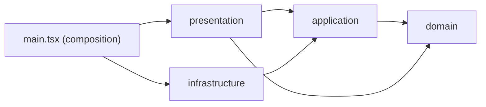
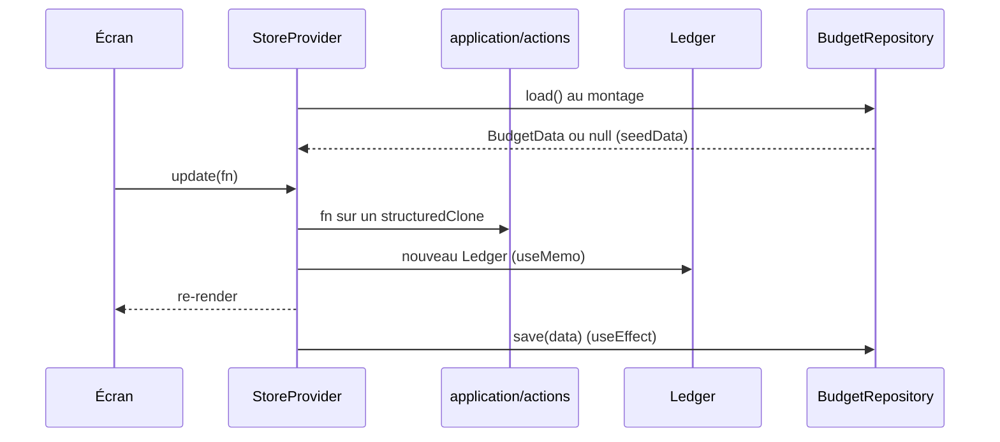

# Architecture — Budget Perso

## 1. Vue d'ensemble

Budget Perso est une application de budget personnel, **desktop uniquement (1440 px)** et **en français**. Elle remplace un Google Sheet et implémente le design Claude Design (`design/project/Budget Perso.dc.html`).

| Élément | Choix |
| --- | --- |
| UI | React 19 |
| Langage | TypeScript 5.9 |
| Build / dev | Vite 8 (port 5180) |
| Tests | Vitest 5 |
| Dépendances runtime | React et React DOM uniquement (pas de routeur, pas de lib d'état) |
| Persistance | `localStorage` aujourd'hui, Supabase prévu |

## 2. Structure des dossiers

Le projet suit la **clean architecture**, les principes **SOLID** et **KISS**.

```
src/
  main.tsx          racine de composition : choisit le repository et l'injecte
  domain/           entités (types) et règles pures : ledger, budget, bank, migrate, format, empty, seed (tests)
  application/      cas d'usage (actions, setup de l'assistant) et ports (BudgetRepository)
  infrastructure/   implémentations des ports : localRepository (Supabase à venir)
  presentation/     App, screens, components, state (store, ui), ds, app.css
supabase/
  migrations/       schéma SQL et RLS
docs/               documentation
design/             handoff et prototype Claude Design
```

### Règle de dépendance

Les dépendances vont toujours vers l'intérieur.



- `domain` ne dépend de rien.
- `application` dépend de `domain`.
- `infrastructure` implémente les ports d'`application`.
- `presentation` appelle `application` et `domain`, jamais `infrastructure`.
- Seul `main.tsx` connaît les implémentations concrètes.

### SOLID

| Principe | Application dans le projet |
| --- | --- |
| **S** | Un fichier, une responsabilité : `Ledger` calcule, `actions` mute, le store orchestre, `localRepository` persiste. |
| **O** | Ajouter un `SupabaseRepository` ne modifie ni le store ni les écrans. |
| **L** | Tout `BudgetRepository` est interchangeable : `load` renvoie les données ou `null`, `save` écrit l'agrégat. |
| **I** | Ports petits et ciblés : `BudgetRepository` n'a que `load` et `save`. |
| **D** | Le store dépend du port `BudgetRepository` et reçoit `repository` et `initialData` par props. |

### KISS : garde-fous

- Un seul agrégat `BudgetData` et un seul repository, pas un repository par entité.
- Pas de conteneur d'injection, de bus d'événements ni de lib d'état.
- Un cas d'usage est une fonction pure, pas une classe.
- On n'ajoute une couche ou une abstraction que si deux implémentations existent ou sont prévues.

## 3. Modèle de domaine

- Un seul agrégat sérialisable, `BudgetData` (version 1). `firstMonth` vaut `null` tant que l'assistant n'a pas créé le premier mois. Il contient le modèle de budget, les mois, les enveloppes, l'historique importé, les relevés de comptes, les transactions, les virements, le prévisionnel, les clôtures et les réglages.
- Six blocs de budget : `rev`, `cre`, `fix`, `var`, `epa`, `inv`. Une `Line` a une `key` stable d'un mois à l'autre.
- `Ledger` calcule mois par mois :
  - les soldes d'enveloppes : jusqu'au mois de départ du compte de l'enveloppe, début + allocation − dépensé ; à partir de ce mois, le solde de son compte (`bankMonth`, spec 0011) ;
  - les soldes de comptes d'épargne et de placement : début + versé − retraits, ou le relevé saisi s'il existe ;
  - les soldes des comptes bancaires (`bankMonth`) : solde de départ + revenus réels + sorties d'épargne + virements « faits » reçus − dépenses (`var`, `env`) − réel des lignes `fix`, `cre`, `epa`, `inv` − virements « faits » envoyés (+ régularisations actives et pointage des lignes `var` vers un compte dédié, voir la puce « Pointage » ci-dessous).
- **Comptes bancaires** (`BudgetData.accounts`) : toujours un compte principal et « Espèces ». Une opération sans `accountId` est sur le compte principal ; changer de principal fige d'abord ces opérations sur l'ancien (toutes les lignes, `var` comprises, le modèle et les transactions). Un compte « hors budget » (`inBudget: false`) est exclu des chiffres du budget (revenus, fixes, crédits, enveloppes, sorties d'épargne) mais reste calculé dans son solde. Exception (spec 0008) : ses dépenses `var` comptent dans le réel de leur ligne ; `realignVariableActuals` (domain/migrate) corrige au chargement les réels détectablement périmés (vides, ou égaux à l'ancien calcul sans les dépenses hors budget) et conserve les saisies manuelles. Les virements ne bougent un solde que s'ils ont un compte bancaire pour destination. Depuis la spec 0009 (amendement 8), une ligne `var` d'un compte hors budget est aussi informative : exclue des totaux du budget, du Reste à sortir et du retard (son réel reste affiché, voir la puce « Pointage »).
- **Mode de paiement par box** (spec 0006) : une ligne `var` porte `payMode?` (`PayMode` : Virtuel par défaut, ou Espèces) et un compte attribué facultatif (`PaymentSetting`, dans `domain/types.ts`). Résolution du compte (RG3, RG4) dans `domain/bank.ts` (`resolveBoxAccountId`) ; cas d'usage dans `application/payment.ts`. `addTransaction` écrit le compte résolu dans la transaction. Une enveloppe n'a plus de mode de paiement depuis la spec 0011 : sa dépense est toujours sur son compte.
- **Compte dédié d'une ligne d'épargne** (spec 0007) : une ligne `epa`/`inv` porte un `linkedAccountId?` (compte bancaire qui reçoit ses versements). `bankFlow` (domain/ledger) ajoute le réel de ces lignes aux entrées du compte dédié et leurs sorties d'épargne à ses sorties ; le solde de la ligne (`accMonth`) reste un calcul séparé. Règles de lien (`canLinkAccount`, `isSavingsWithdrawalAllowed`) dans `domain/bank.ts`, action `setLineLinkedAccount` dans `application/bankAccounts.ts`. Le « solde estimé » affiché dans les blocs Épargnes et Investissements est `estimatedBalance` (domain/budget) : calculé, jamais stocké.
- **Type de compte** (spec 0010) : `BankAccount.kind?` (`courant` par défaut, `epargne`, `invest`, `enveloppe`, le compte d'une enveloppe, spec 0011) ne sert qu'à classer le compte dans un seul groupe de la clôture. Une ligne `epa`/`inv` liée par `linkedAccountId` à un compte existant n'a pas de ligne propre dans la clôture : son compte (`bankMonth`) la représente. `canLinkAccount` exige le bon type (`epargne` pour `epa`, `invest` pour `inv`). Lecture et déduction dans `domain/accountKind.ts` (candidats d'après le nom, jamais écrits sans confirmation), groupes de la clôture dans `domain/closing.ts`, cas d'usage dans `application/accountKinds.ts`.
- **Pointage** (spec 0009, amendement 4) : `MonthData.checks` (date de pointage par ligne, sans montant ; « reçu » pour un revenu), `MonthData.accountBalances` (relevé bancaire daté, un par compte et par mois), `BudgetData.adjustments?` (régularisations « écart constaté », annulables, jamais supprimées) et `Settings.pointageStart?` sont facultatifs : aucune migration de version. `Line`/`TemplateLine` portent `dueDay?` et `execMode?`. Un seul solde de départ par compte (onglet Comptes). `domain/bankMovements.ts` liste les mouvements datés d'un compte pour un mois, au réel (`actual`) ou au pointage (`checks`) ; le montant d'une ligne pointée n'est jamais stocké : `countedAmount` (domain/bankMovements) donne son réel s'il existe, sinon son budget, et sert aux mouvements, au Reste à sortir et aux Revenus attendus ; le `Ledger` (réel) et `domain/checkoff.ts` (`monthBalance`, Solde estimé continu : début de mois = fin du précédent, mêmes reports de clôture `bank:<id>`) s'appuient sur cette même liste, d'où l'égalité Solde estimé = solde de l'écran Comptes sur tout mois au réel. À partir de `pointageStart` (posé au premier pointage, modifiable dans l'onglet Comptes, mois clôturé protégé), un mois est compté au pointage. L'écart = relevé − Solde estimé à la date du relevé ; une régularisation active compte dans le Solde estimé et dans le solde du `Ledger`, jamais dans les chiffres du budget. Épargne (`statements`) inchangée. Les revenus se pointent (« reçu » : entrée du Solde estimé) ; non reçus, ils sont des « Revenus attendus » hors Marge. Le pointage d'une ligne `var` sur compte dédié déplace son budget du principal vers le compte dédié dans les deux modes. Allocations d'enveloppes : voir la puce « Une enveloppe = un compte » ci-dessous (spec 0011, qui remplace l'amendement 6). Un compte hors budget n'affecte jamais le principal (ligne `var` pointée, anciens virements « faits ») : il enregistre seul son côté. « Reste à placer », part `cash` et soldes d'enveloppes du Ledger inchangés. Une ligne `var` dont le compte résolu est hors budget est informative (`isLineInBudget` l'écarte des totaux du budget, du Reste à sortir et de la Marge ; classement calculé, rétroactif ; export CSV avec colonne « Hors budget »). Le détail du principal liste en gris les contreparties ignorées (`ignoredMovements`, fonction pure séparée de `bankMovements`, jamais sommée). Les virements (`transfers`, `transfersDone`) n'ont plus ni interface ni action : leurs données restent lues pour ne pas changer les soldes passés.
- **Une enveloppe = un compte** (spec 0011) : `Envelope.accountId` (obligatoire) désigne un compte `BankAccount` de `kind: 'enveloppe'`, créé, renommé et archivé avec l'enveloppe (`application/envelopes.ts`). L'allocation du mois est un mouvement du compte principal vers ce compte, lu par `bankMovements` pour l'écran Comptes comme pour le Solde estimé : au 1er du mois en mois « au réel », au pointage (`MonthData.checks['env:<id>']`, date seule) en mois « au pointage ». La dépense `env` est toujours sur le compte de l'enveloppe (`addTransaction` impose le compte). Le mouvement est lu depuis les comptes d'enveloppe (`BankAccount.envelopeId`), pas depuis les enveloppes : supprimer une enveloppe vide archive son compte et garde ses allocations passées dans l'historique du principal. Une dépense `var` sur une ligne à compte attribué est aussi figée sur ce compte (`fixedTransactionAccountId`). La case de pointage de l'allocation n'existe qu'en mois « au pointage ». Jusqu'au mois d'ouverture du compte (`envelopeAccountAt`), l'ancien calcul `envMonth` (historique, anciens pointages avec leur compte de destination) reste en lecture. Un compte `enveloppe` est toujours dans le budget, absent des listes de choix (`activeBankAccounts`), sans nom ni type modifiables depuis les Comptes ; il groupe la clôture « Enveloppes » (`closingView`, une ligne par compte, ajustement `bank:<id>`). Supprimer une enveloppe vide archive son compte (jamais effacé).
- **Migration** : `migrateBankAccounts` (domain) ajoute les comptes aux données qui n'en ont pas, au chargement, de façon idempotente.
- Les cas d'usage (`application/actions.ts`) sont des fonctions qui modifient une copie des données.
- **Disponible à placer (réel)** : `availableReal` (domain/budget) = Reste à placer budgété, corrigé des écarts de revenus du compte principal et des versements d'épargne/placement. Calculé, jamais stocké (spec 0005).
- **Clôture d'un mois** : `MonthData.closed` verrouille un seul mois (`isMonthLocked` = année clôturée ou mois clôturé). Cas d'usage dans `application/monthClosing.ts` : clôture refusée si le mois précédent initialisé n'est pas clôturé ou si le disponible ≠ 0, seul le dernier mois clôturé se rouvre ([ADR 0004](adr/0004-cloture-d-un-mois-par-un-indicateur-sur-le-mois.md)).
- **Clôture d'année** : elle verrouille les mois de l'année. Janvier suivant repart des soldes du 31 décembre, ajustables via `YearClose.overrides`.

## 4. État et flux de données



- `StoreProvider` ne rend rien tant que le chargement n'est pas terminé.
- Sans données, il utilise `initialData()`, injecté par `main.tsx` : `emptyData` (budget vide, `firstMonth: null`). `seedData` (chiffres de décembre 2026) ne sert plus qu'aux tests.
- Tant que `firstMonth` est `null`, l'application n'affiche que l'écran « Démarrage » (assistant en 9 étapes). `createFirstMonth` (`application/actions.ts`) crée le premier mois à partir du brouillon ; les soldes de départ des épargnes et enveloppes sont stockés comme soldes de fin du mois précédent (ADR 0001), ceux des comptes bancaires sur le compte lui-même (`openingBalance`).
- Le brouillon de l'assistant vit dans `localStorage` (clé `budget-perso:setup-draft`), hors de `BudgetData` (ADR 0002).
- La sauvegarde se déclenche à chaque changement de `data`, sans debounce, sur l'agrégat entier.
- `presentation/state/ui.tsx` gère les menus contextuels et popovers, séparément des données.
- L'écran actif et le mois courant sont un état local de `presentation/App.tsx`.

## 5. Données et Supabase

### Interface de persistance

```ts
interface BudgetRepository {
  load(): Promise<BudgetData | null>;
  save(data: BudgetData): Promise<void>;
}
```

C'est un port défini dans `application/ports.ts`, seule porte d'accès à la persistance. `infrastructure/localRepository.ts` sérialise tout sous la clé `budget-perso:v1` et ignore les erreurs de stockage.

### Schéma Supabase

Défini dans `supabase/migrations/20261020000000_init_schema.sql` : 13 tables (`settings`, `template_lines`, `months`, `budget_lines`, `envelopes`, `envelope_allocations`, `envelope_history`, `account_statements`, `transactions`, `transfers`, `transfers_done`, `planned_items`, `year_closes`).

- Chaque table porte un `user_id`.
- La RLS « own rows » limite l'accès à `user_id = auth.uid()`.
- `src/domain/database.types.ts` est généré avec `generate_typescript_types`.
- Le projet Supabase est relié via `.mcp.json`.

### Stratégie de synchronisation cible : diff par table

Un `save(data)` complet à chaque changement ne passe pas à l'échelle avec un schéma relationnel. La cible est un `SupabaseRepository` qui :

1. garde le dernier état synchronisé ;
2. compare l'ancien et le nouvel agrégat table par table ;
3. n'envoie que les `upsert` et `delete` des lignes modifiées.

Le store et les écrans ne changent pas : on change le repository passé à `<StoreProvider>` dans `main.tsx`.

## 6. Décisions d'architecture

| # | Décision | Raison |
| --- | --- | --- |
| 1 | Clean architecture : domain, application, infrastructure, presentation | Dépendances vers l'intérieur ; le domaine et les cas d'usage se testent seuls avec Vitest. |
| 2 | Contexte React plutôt qu'une lib d'état | Un seul agrégat, app mono-utilisateur, aucune dépendance en plus. |
| 3 | Mutations par `structuredClone` + fonction | Pas de lib d'immutabilité, actions simples à tester. |
| 4 | `Ledger` dérivé, jamais persisté | Les soldes se recalculent depuis `BudgetData` : une seule source de vérité. |
| 5 | `BudgetRepository` comme port, injecté depuis `main.tsx` | Inversion de dépendance : on change de persistance sans toucher aux écrans ni au store. |
| 6 | Sync cible par diff par table | Écritures minimales sans modifier le store ni les actions. |
| 7 | RLS par `user_id` | L'isolation des données est garantie par la base, pas par le client. |
| 8 | CSS transcrit du prototype sur le design system Organic | Fidélité au design, pas de framework CSS. |
| 9 | Soldes de départ = soldes de fin du mois précédent | Réutilise `statements` et `envHistory`, sans changer le schéma ([ADR 0001](adr/0001-soldes-de-depart-via-le-mois-precedent.md)). |
| 10 | Brouillon de l'assistant en `localStorage`, hors `BudgetData` | État temporaire, une seule implémentation, pas de nouveau port ([ADR 0002](adr/0002-brouillon-de-l-assistant-en-local-storage.md)). |
| 11 | Clôture d'un mois par `MonthData.closed` | Réutilise le garde-fou `isMonthLocked` ([ADR 0004](adr/0004-cloture-d-un-mois-par-un-indicateur-sur-le-mois.md)). |
| 12 | Solde estimé continu, bascule réel / pointage (`settings.pointageStart`), régularisation tracée, contreparties entre comptes, comptes hors budget isolés (mouvements ignorés listés en gris par `ignoredMovements`, jamais sommés), une enveloppe = un compte (spec 0011) | Un solde de départ, une source de mouvements partagée avec le `Ledger`, écart corrigé sans réécrire l'historique ([ADR 0005](adr/0005-solde-estime-continu-et-regularisation.md)) ; une enveloppe = un compte ([ADR 0006](adr/0006-une-enveloppe-un-compte-bancaire.md)). |

## 7. Tests et qualité

- Vitest couvre le domaine et les cas d'usage :
  - `budget.test.ts` vérifie les chiffres du design (reste à placer 2 950 €, épargne brute 2 060 €, taux d'épargne réel 20,2 %) ;
  - `application/actions.test.ts` vérifie les cas d'usage.
- L'UI n'a pas de tests.
- `npm run build` exécute `tsc --noEmit` puis `vite build` : une erreur de type bloque le build.

## 8. Roadmap et dette technique

- Implémenter `SupabaseRepository` avec diff par table, et ajouter l'authentification. La migration rendant `settings.first_month` nullable (`firstMonth: null` côté domaine) est à écrire avec cette spec.
- Migrer les données `localStorage` existantes vers Supabase.
- Ajouter des tests d'UI et configurer un linter.
- Ajouter un test de contrat réutilisable pour valider chaque implémentation de `BudgetRepository` (Liskov).
- Ajouter un écran de chargement et la gestion d'erreur au démarrage du store.
- Gérer les conflits multi-onglets et multi-appareils.
- Aucun support hors desktop 1440 px.

## 9. Workflow Git

Le projet suit **Gitflow**. Chaque feature ou correctif est développé dans sa propre branche.

### Branches

- `main` : production, uniquement des releases et des hotfixes, taguées `vX.Y.Z`.
- `develop` : intégration, point de départ de toutes les features.
- Jamais de commit direct sur `main` ni sur `develop`.

### Nommage

`<type>/<description_en_snake_case>`, en minuscules et sans accents.

| Type | Part de | Revient dans | Exemple |
| --- | --- | --- | --- |
| `feat` | `develop` | `develop` | `feat/initialize_budget` |
| `fix` | `develop` | `develop` | `fix/budget_display` |
| `chore` | `develop` | `develop` | `chore/update_dependencies` |
| `docs` | `develop` | `develop` | `docs/architecture` |
| `release` | `develop` | `main` puis `develop` | `release/1_2_0` |
| `hotfix` | `main` | `main` puis `develop` | `hotfix/envelope_balance` |

### Intégration

- Rebase sur la branche cible, puis fast-forward : l'historique reste linéaire, sans commit de merge.
- **3 commits maximum** par branche de feature, au format gitmoji (skill `commit-gitmoji`).
- Après un `release` ou un `hotfix` dans `main`, on pose le tag et on reporte dans `develop`.

### Skill dédié

Le skill `.claude/skills/git-branch/SKILL.md` applique cette convention : il valide le nom, choisit la branche source et crée la branche. Il refuse de travailler directement sur `main` ou `develop`.
