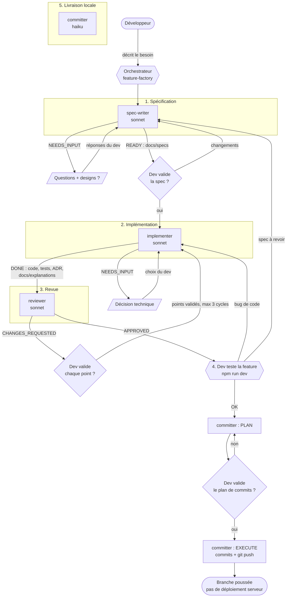

# Workflow de la factory d'agents

Une feature passe par cinq étapes pilotées par l'orchestrateur (skill [`feature-factory`](../.claude/skills/feature-factory/SKILL.md)). Les agents sont dans [`.claude/agents/`](../.claude/agents/).

**Règle d'or : aucune décision sans confirmation du développeur.** Tout point bloquant remonté par un agent lui est présenté avant d'être transmis ou appliqué.

## Vue d'ensemble

## Qui fait quoi

| Agent | Modèle | Outils | Entrée | Sortie |
| --- | --- | --- | --- | --- |
| Orchestrateur (skill) | session | tous | besoin du dev | relais, validations, enchaînement |
| [`spec-writer`](../.claude/agents/spec-writer.md) | sonnet | lecture, écriture docs | besoin, designs | `docs/specs/NNNN-*.md` |
| [`implementer`](../.claude/agents/implementer.md) | sonnet | lecture, écriture, bash | spec validée, retours validés | code, tests, `docs/adr/`, `docs/explanations/` |
| [`reviewer`](../.claude/agents/reviewer.md) | sonnet | lecture, bash (sans écriture) | spec, branche | verdict `APPROVED` ou `CHANGES_REQUESTED` |
| [`committer`](../.claude/agents/committer.md) | haiku | bash, git, skills | plan validé | commits gitmoji et push |

## Points de validation du développeur

| # | Quand | Ce qu'il décide |
| --- | --- | --- |
| 1 | Pendant la spec | Réponses aux questions, existence ou non de designs |
| 2 | Fin de spec | Valider ou demander des changements |
| 3 | Pendant l'implémentation | Chaque choix technique structurant (puis ADR) |
| 4 | Après la revue | Chaque bloquant, important ou suggestion à appliquer |
| 5 | Test manuel | OK, bug de code ou spec à revoir |
| 6 | Avant les commits | Plan de commits (3 max) |

Tout autre blocage (test en échec, push rejeté, conflit) est aussi présenté avant toute action.

## Protocole entre agents

Chaque agent termine par un bloc `STATUS:`.

| Agent | Statuts |
| --- | --- |
| spec-writer | `NEEDS_INPUT`, `READY` |
| implementer | `NEEDS_INPUT`, `DONE` |
| reviewer | `APPROVED`, `CHANGES_REQUESTED` |
| committer | `PLAN_READY`, `DONE`, `BLOCKED` |

## Où vont les fichiers

| Dossier | Contenu | Versionné |
| --- | --- | --- |
| `docs/specs/` | spécifications | oui |
| `docs/adr/` | décisions d'architecture | oui |
| `docs/explanations/` | explications pédagogiques pour le dev | **non** (gitignore) |
| `docs/workflow.md` | ce document | oui |

## Limites

- Les sous-agents ne peuvent ni interroger le développeur ni lancer d'autres agents : tout passe par l'orchestrateur.
- La livraison s'arrête au push de la branche : pas de merge, de tag, de PR ni de déploiement.
